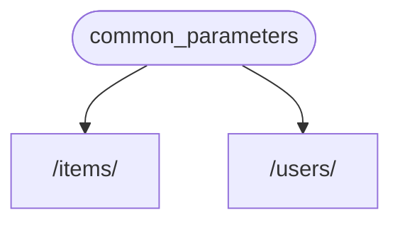
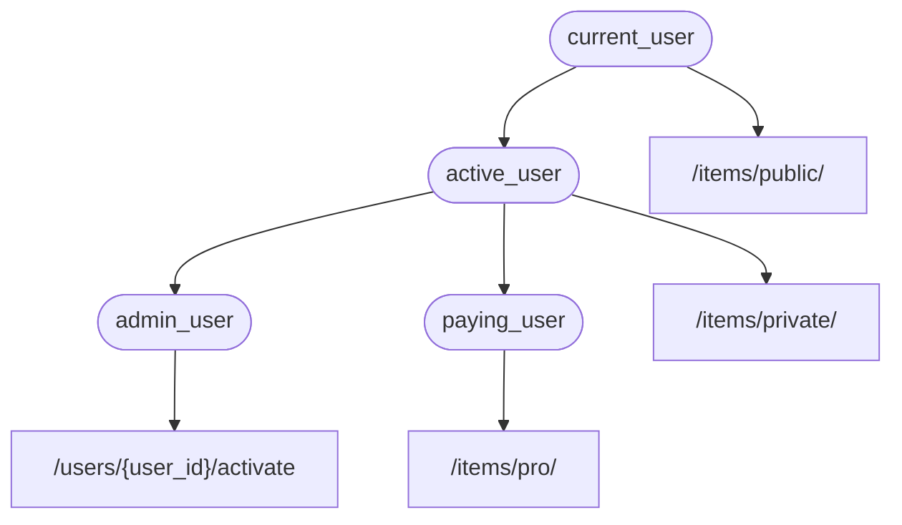

# Dependencies { #dependencies }

**FastAPI**-এর একটি খুবই শক্তিশালী কিন্তু সহজে বোঝা যায় এমন **<dfn title="এগুলো নামেও পরিচিত: components, resources, providers, services, injectables">Dependency Injection</dfn>** system আছে।

এটা এমনভাবে design করা যে ব্যবহার করা খুব সহজ, আর যেকোনো developer খুব সহজেই অন্য components **FastAPI**-এর সাথে integrate করতে পারেন।

## "Dependency Injection" কী { #what-is-dependency-injection }

programming-এ **"Dependency Injection"** মানে হলো, আপনার code (এখানে আপনার *path operation functions*) কাজ করতে আর ব্যবহার করতে যা যা লাগে, সেগুলো declare করার একটা উপায় থাকে: "dependencies"।

তারপর ওই system (এখানে **FastAPI**) আপনার code-কে দরকারি dependencies দেওয়ার জন্য যা যা করা দরকার, সব নিজেই করে নেয় (dependencies "inject" করে)।

এটা খুব কাজে লাগে যখন দরকার হয়:

* shared logic রাখা (একই code logic বারবার)।
* database connections share করা।
* security, authentication, role requirements, ইত্যাদি enforce করা।
* আর আরও অনেক কিছু...

এই সবকিছু, code-এর পুনরাবৃত্তি যতটা সম্ভব কমিয়ে।

## প্রথম ধাপ { #first-steps }

খুব সহজ একটি উদাহরণ দেখা যাক। এতটাই সহজ যে আপাতত খুব একটা কাজের না।

কিন্তু এভাবে আমরা **Dependency Injection** system কীভাবে কাজ করে, সেদিকে মনোযোগ দিতে পারব।

### একটি dependency, বা "dependable" বানান { #create-a-dependency-or-dependable }

প্রথমে dependency-টা দেখা যাক।

এটা শুধু একটি function, যেটা একটি *path operation function*-এর মতোই সব parameters নিতে পারে:

{* ../../docs_src/dependencies/tutorial001_an_py310.py hl[8:9] *}

ব্যস।

**2 line**।

আর আপনার সব *path operation functions*-এর যে গঠন আর structure, এটারও তাই।

এটাকে "decorator" ছাড়া (`@app.get("/some-path")` ছাড়া) একটি *path operation function* হিসেবে ভাবতে পারেন।

আর এটা আপনার যা ইচ্ছা তাই return করতে পারে।

এখানে এই dependency আশা করে:

* একটি optional query parameter `q`, যেটা একটি `str`।
* একটি optional query parameter `skip`, যেটা একটি `int`, আর default-ভাবে `0`।
* একটি optional query parameter `limit`, যেটা একটি `int`, আর default-ভাবে `100`।

তারপর এটা শুধু ওই values-সহ একটি `dict` return করে।

/// note | Note

FastAPI version 0.95.0-এ `Annotated`-এর support যোগ করেছে (আর এটা recommend করা শুরু করেছে)।

পুরোনো version থাকলে `Annotated` ব্যবহার করতে গেলে errors পাবেন।

`Annotated` ব্যবহারের আগে [FastAPI version upgrade করে](../../deployment/versions.md#upgrading-the-fastapi-versions) অন্তত 0.95.1 করে নিন।

///

### `Depends` import করুন { #import-depends }

{* ../../docs_src/dependencies/tutorial001_an_py310.py hl[3] *}

### "dependant"-এ dependency declare করুন { #declare-the-dependency-in-the-dependant }

আপনার *path operation function* parameters-এ যেভাবে `Body`, `Query`, ইত্যাদি ব্যবহার করেন, সেভাবেই একটি নতুন parameter-এ `Depends` ব্যবহার করুন:

{* ../../docs_src/dependencies/tutorial001_an_py310.py hl[13,18] *}

function-এর parameters-এ `Body`, `Query`, ইত্যাদির মতো করেই `Depends` ব্যবহার করলেও, `Depends` একটু আলাদাভাবে কাজ করে।

`Depends`-কে শুধু একটি parameter দেওয়া হয়।

এই parameter-টা অবশ্যই function-এর মতো কিছু একটা হতে হবে।

এটা সরাসরি **call করবেন না** (শেষে parenthesis দেবেন না), শুধু `Depends()`-এ parameter হিসেবে পাঠিয়ে দিন।

আর সেই function, *path operation functions*-এর মতো করেই parameters নেয়।

/// tip | Tip

functions ছাড়া আর কী কী "জিনিস" dependencies হিসেবে ব্যবহার করা যায়, সেটা পরের chapter-এ দেখবেন।

///

যখনই একটি নতুন request আসে, **FastAPI** নিজেই:

* সঠিক parameters দিয়ে আপনার dependency ("dependable") function call করবে।
* আপনার function থেকে result নেবে।
* সেই result আপনার *path operation function*-এর parameter-এ বসিয়ে দেবে।



এভাবে shared code একবার লেখেন, আর **FastAPI** আপনার *path operations*-এর জন্য সেটা call করার দায়িত্ব নেয়।

/// tip | Tip

খেয়াল করুন, এটা "register" করার জন্য কোনো special class বানিয়ে **FastAPI**-কে কোথাও পাঠাতে হয় না, বা এরকম কিছুই করতে হয় না।

শুধু `Depends`-এ দিয়ে দিন, বাকিটা **FastAPI** জানে কীভাবে করতে হয়।

///

## `Annotated` dependencies share করুন { #share-annotated-dependencies }

উপরের উদাহরণগুলোতে দেখছেন, একটুখানি **code duplication** আছে।

`common_parameters()` dependency ব্যবহার করতে হলে type annotation আর `Depends()`-সহ পুরো parameter লিখতে হয়:

```Python
commons: Annotated[dict, Depends(common_parameters)]
```

কিন্তু যেহেতু আমরা `Annotated` ব্যবহার করছি, তাই ওই `Annotated` value একটি variable-এ রেখে একাধিক জায়গায় ব্যবহার করতে পারি:

{* ../../docs_src/dependencies/tutorial001_02_an_py310.py hl[12,16,21] *}

/// tip | Tip

এটা শুধু standard Python, এটাকে বলে "type alias", এটা আসলে **FastAPI**-এর নিজস্ব কিছু নয়।

কিন্তু যেহেতু **FastAPI** `Annotated` সহ Python standards-এর উপর ভিত্তি করে বানানো, তাই আপনার code-এ এই কৌশলটা ব্যবহার করতে পারেন। 😎

///

dependencies আগের মতোই কাজ করবে, আর **সবচেয়ে ভালো ব্যাপার** হলো **type information ঠিক থাকবে**, মানে আপনার editor আপনাকে **autocompletion**, **inline errors**, ইত্যাদি দিয়ে যেতে পারবে। `mypy`-এর মতো অন্য tools-এর ক্ষেত্রেও একই।

এটা বিশেষ করে কাজে লাগবে যখন একটি **বড় code base**-এ **অনেক *path operations***-এ **একই dependencies** বারবার ব্যবহার করবেন।

## `async` হবে কি হবে না { #to-async-or-not-to-async }

যেহেতু dependencies-ও **FastAPI** call করবে (আপনার *path operation functions*-এর মতোই), তাই আপনার functions define করার সময় একই নিয়ম খাটে।

`async def` বা সাধারণ `def` ব্যবহার করতে পারেন।

আর সাধারণ `def` *path operation functions*-এর ভেতরে `async def` দিয়ে dependencies declare করতে পারেন, বা `async def` *path operation functions*-এর ভেতরে `def` dependencies, ইত্যাদি।

এতে কিছু যায় আসে না। **FastAPI** জানবে কী করতে হবে।

/// note | Note

না জানলে docs-এ `async` আর `await` নিয়ে [Async: *"In a hurry?"*](../../async.md#in-a-hurry) section-টি দেখুন।

///

## OpenAPI-এর সাথে integrated { #integrated-with-openapi }

আপনার dependencies (আর sub-dependencies)-এর সব request declarations, validations আর requirements একই OpenAPI schema-তে integrate হবে।

তাই interactive docs-এ এই dependencies-এর সব তথ্যও থাকবে:


## সহজ ব্যবহার { #simple-usage }

খেয়াল করলে দেখবেন, *path operation functions* এমনভাবে declare করা হয় যে যখনই একটি *path* আর *operation* match করে, তখন ব্যবহার হয়, আর **FastAPI** request থেকে data বের করে সঠিক parameters দিয়ে function-টা call করার দায়িত্ব নেয়।

আসলে সব (বা বেশিরভাগ) web frameworks এভাবেই কাজ করে।

ওই functions আপনি কখনো সরাসরি call করেন না। আপনার framework (এখানে **FastAPI**) এগুলো call করে।

Dependency Injection system দিয়ে আপনি **FastAPI**-কে এটাও বলে দিতে পারেন যে আপনার *path operation function* আরও কিছুর উপর "depend" করে, যেটা আপনার *path operation function*-এর আগে চালাতে হবে, আর **FastAPI** সেটা চালিয়ে results "inject" করার দায়িত্ব নেবে।

"dependency injection"-এর এই একই idea-র জন্য আরও কিছু প্রচলিত terms হলো:

* resources
* providers
* services
* injectables
* components

## **FastAPI** plug-ins { #fastapi-plug-ins }

**Dependency Injection** system দিয়ে integrations আর "plug-ins" বানানো যায়। কিন্তু আসলে **"plug-ins" বানানোর কোনো দরকারই নেই**, কারণ dependencies ব্যবহার করে অসীম সংখ্যক integrations আর interactions declare করা যায়, যেগুলো আপনার *path operation functions*-এর জন্য available হয়ে যায়।

আর dependencies এত সহজভাবে বানানো যায় যে শুধু দরকারি Python packages import করে, *আক্ষরিক অর্থেই* কয়েক line code-এ সেগুলো আপনার API functions-এর সাথে integrate করতে পারবেন।

এর উদাহরণ পরের chapters-এ দেখবেন: relational আর NoSQL databases, security, ইত্যাদি নিয়ে।

## **FastAPI** compatibility { #fastapi-compatibility }

dependency injection system এত সহজ হওয়ার কারণে **FastAPI** compatible:

* সব relational databases-এর সাথে
* NoSQL databases-এর সাথে
* external packages-এর সাথে
* external APIs-এর সাথে
* authentication আর authorization systems-এর সাথে
* API usage monitoring systems-এর সাথে
* response data injection systems-এর সাথে
* ইত্যাদি।

## সহজ এবং শক্তিশালী { #simple-and-powerful }

hierarchical dependency injection system define আর ব্যবহার করা খুব সহজ হলেও, এটা এখনো খুবই শক্তিশালী।

আপনি এমন dependencies define করতে পারেন, যেগুলো নিজেরাও আবার dependencies define করতে পারে।

শেষে dependencies-এর একটি hierarchical tree তৈরি হয়, আর **Dependency Injection** system আপনার জন্য এই সব dependencies (আর তাদের sub-dependencies) solve করে, প্রতিটি ধাপে results দিয়ে (inject করে) দেয়।

যেমন ধরুন আপনার 4টি API endpoints (*path operations*) আছে:

* `/items/public/`
* `/items/private/`
* `/users/{user_id}/activate`
* `/items/pro/`

তাহলে শুধু dependencies আর sub-dependencies দিয়েই প্রতিটার জন্য আলাদা permission requirements যোগ করতে পারেন:



## **OpenAPI**-এর সাথে integrated { #integrated-with-openapi_1 }

এই সব dependencies তাদের requirements declare করার সময় আপনার *path operations*-এ parameters, validations, ইত্যাদিও যোগ করে।

**FastAPI** এগুলো সব OpenAPI schema-তে যোগ করার দায়িত্ব নেবে, যাতে interactive documentation systems-এ দেখানো যায়।
