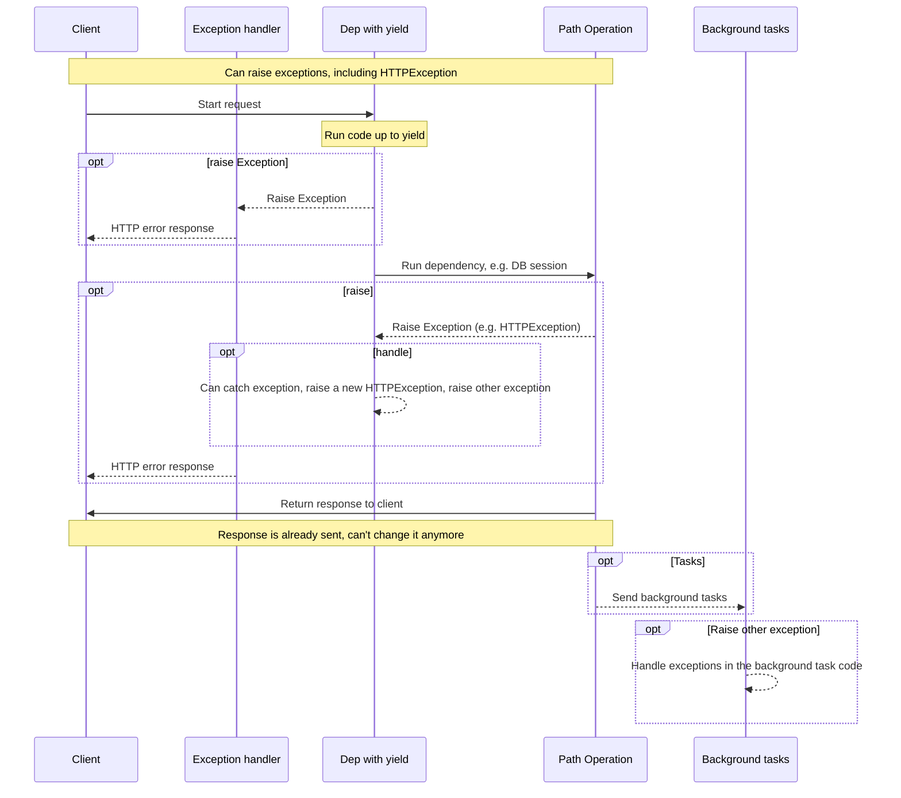
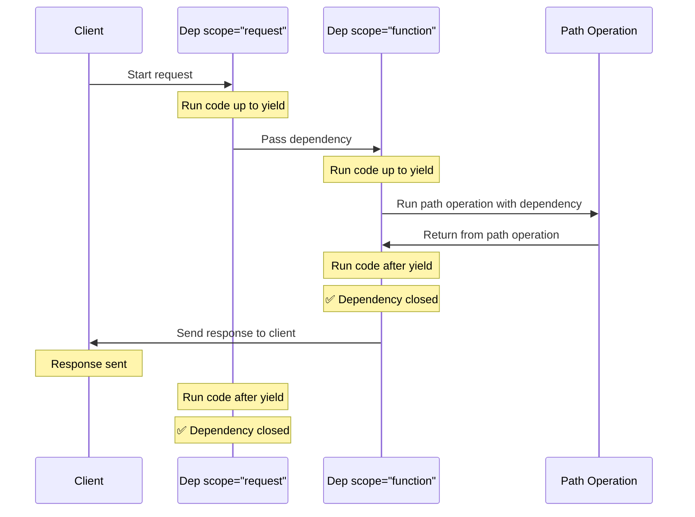

# Vitegemezi vyenye yield { #dependencies-with-yield }

FastAPI inasaidia vitegemezi vinavyotekeleza <dfn title='wakati mwingine pia huitwa "msimbo wa kuachilia rasilimali", "msimbo wa usafishaji", "msimbo wa kufunga", "msimbo wa kuondoka kwenye context manager", n.k.'>hatua za ziada baada ya kumaliza</dfn>.

Ili kufanya hivyo, tumia `yield` badala ya `return`, kisha andika hatua za ziada (msimbo) baada yake.

/// tip | Kidokezo

Hakikisha unatumia `yield` mara moja tu kwa kila kitegemezi.

///

/// note | Maelezo ya Kiufundi

Function yoyote inayofaa kutumiwa na:

* [`@contextlib.contextmanager`](https://docs.python.org/3/library/contextlib.html#contextlib.contextmanager) au
* [`@contextlib.asynccontextmanager`](https://docs.python.org/3/library/contextlib.html#contextlib.asynccontextmanager)

inafaa kutumiwa kama kitegemezi cha **FastAPI**.

Kwa kweli, FastAPI hutumia decorators hizo mbili ndani yake.

///

## Kitegemezi cha hifadhidata chenye `yield` { #a-database-dependency-with-yield }

Kwa mfano, unaweza kutumia hili kuunda session ya hifadhidata na kuifunga baada ya kumaliza.

Ni msimbo ulio kabla ya kauli ya `yield`, pamoja na kauli hiyo yenyewe, pekee unaotekelezwa kabla ya kuunda jibu:

{* ../../docs_src/dependencies/tutorial007_py310.py hl[2:4] *}

Thamani inayotolewa na `yield` ndiyo inayoingizwa kwenye *operesheni za njia* na vitegemezi vingine:

{* ../../docs_src/dependencies/tutorial007_py310.py hl[4] *}

Msimbo unaofuata kauli ya `yield` hutekelezwa baada ya jibu:

{* ../../docs_src/dependencies/tutorial007_py310.py hl[5:6] *}

/// tip | Kidokezo

Unaweza kutumia functions za `async` au za kawaida.

**FastAPI** itashughulikia kila moja ipasavyo, kama inavyofanya kwa vitegemezi vya kawaida.

///

## Kitegemezi chenye `yield` na `try` { #a-dependency-with-yield-and-try }

Ukitumia block ya `try` kwenye kitegemezi chenye `yield`, utapokea exception yoyote iliyozalishwa wakati wa kutumia kitegemezi hicho.

Kwa mfano, ikiwa msimbo fulani wakati wa utekelezaji, kwenye kitegemezi kingine au kwenye *operesheni ya njia*, ulisababisha muamala wa hifadhidata kufanya "rollback" au ulizalisha exception nyingine yoyote, ungepokea exception hiyo kwenye kitegemezi chako.

Kwa hiyo, unaweza kutambua exception hiyo mahususi ndani ya kitegemezi kwa kutumia `except SomeException`.

Vivyo hivyo, unaweza kutumia `finally` kuhakikisha kwamba hatua za kuachilia rasilimali zinatekelezwa, bila kujali kama kulikuwa na exception au la.

{* ../../docs_src/dependencies/tutorial007_py310.py hl[3,5] *}

## Vitegemezi vya vitegemezi vingine vyenye `yield` { #sub-dependencies-with-yield }

Unaweza kuwa na vitegemezi vya vitegemezi vingine na "miti" ya vitegemezi hivyo ya ukubwa na umbo lolote, na chochote au vyote vinaweza kutumia `yield`.

**FastAPI** itahakikisha kwamba "msimbo wa kuachilia rasilimali" katika kila kitegemezi chenye `yield` unaendeshwa kwa mpangilio sahihi.

Kwa mfano, `dependency_c` kinaweza kutegemea `dependency_b`, na `dependency_b` kikategemea `dependency_a`:

{* ../../docs_src/dependencies/tutorial008_an_py310.py hl[6,14,22] *}

Na vyote vinaweza kutumia `yield`.

Katika hali hii, ili `dependency_c` kitekeleze msimbo wake wa kuachilia rasilimali, kinahitaji thamani kutoka `dependency_b` (hapa inaitwa `dep_b`) iendelee kupatikana.

Nacho `dependency_b` kinahitaji thamani kutoka `dependency_a` (hapa inaitwa `dep_a`) ipatikane kwa ajili ya msimbo wake wa kuachilia rasilimali.

{* ../../docs_src/dependencies/tutorial008_an_py310.py hl[18:19,26:27] *}

Vivyo hivyo, unaweza kuwa na baadhi ya vitegemezi vyenye `yield` na vingine vyenye `return`, na baadhi yake vikategemea vingine.

Na unaweza kuwa na kitegemezi kimoja kinachohitaji vitegemezi vingine kadhaa vyenye `yield`, n.k.

Unaweza kuwa na mchanganyiko wowote wa vitegemezi unaotaka.

**FastAPI** itahakikisha kila kitu kinaendeshwa kwa mpangilio sahihi.

/// note | Maelezo ya Kiufundi

Hili linawezekana kutokana na [Context Managers](https://docs.python.org/3/library/contextlib.html) za Python.

**FastAPI** huzitumia ndani yake kufanikisha hili.

///

## Vitegemezi vyenye `yield` na `HTTPException` { #dependencies-with-yield-and-httpexception }

Umeona kwamba unaweza kutumia vitegemezi vyenye `yield` na kuwa na block za `try` zinazojaribu kutekeleza msimbo fulani, kisha kuendesha msimbo wa kuachilia rasilimali baada ya `finally`.

Unaweza pia kutumia `except` kunasa exception iliyozalishwa na kuifanyia jambo fulani.

Kwa mfano, unaweza kuzalisha exception tofauti, kama `HTTPException`.

/// tip | Kidokezo

Hii ni mbinu ya kiwango cha juu kiasi, na katika hali nyingi hutaihitaji, kwa kuwa unaweza kuzalisha exceptions (ikiwemo `HTTPException`) kutoka sehemu nyingine za msimbo wa programu yako, kwa mfano, kwenye *function ya operesheni ya njia*.

Lakini ipo kwa ajili yako ukiihitaji. 🤓

///

{* ../../docs_src/dependencies/tutorial008b_an_py310.py hl[18:22,31] *}

Ikiwa unataka kunasa exceptions na kuunda jibu maalum kulingana nazo, unda [Kishughulikiaji Maalum cha Exceptions](../handling-errors.md#install-custom-exception-handlers).

## Vitegemezi vyenye `yield` na `except` { #dependencies-with-yield-and-except }

Ukinasa exception kwa kutumia `except` kwenye kitegemezi chenye `yield` na usiizalishe tena (au kuzalisha exception mpya), FastAPI haitaweza kutambua kwamba kulikuwa na exception, kama ambavyo ingetokea katika Python ya kawaida:

{* ../../docs_src/dependencies/tutorial008c_an_py310.py hl[15:16] *}

Katika hali hii, mteja ataona jibu la *HTTP 500 Internal Server Error* kama inavyopaswa, kwa kuwa hatuzalishi `HTTPException` au kitu kama hicho, lakini seva **haitakuwa na kumbukumbu zozote** wala dalili nyingine yoyote ya kosa lililokuwa limetokea. 😱

### Tumia `raise` kila wakati katika Vitegemezi vyenye `yield` na `except` { #always-raise-in-dependencies-with-yield-and-except }

Ukinasa exception kwenye kitegemezi chenye `yield`, isipokuwa kama unazalisha `HTTPException` nyingine au kitu kama hicho, **unapaswa kuzalisha tena exception ya awali**.

Unaweza kuzalisha tena exception ileile kwa kutumia `raise`:

{* ../../docs_src/dependencies/tutorial008d_an_py310.py hl[17] *}

Sasa mteja atapata jibu lilelile la *HTTP 500 Internal Server Error*, lakini seva itakuwa na `InternalError` yetu maalum katika kumbukumbu. 😎

## Utekelezaji wa vitegemezi vyenye `yield` { #execution-of-dependencies-with-yield }

Mfuatano wa utekelezaji unafanana kwa kiasi kikubwa na mchoro huu. Muda unasonga kutoka juu kwenda chini. Na kila safu wima ni mojawapo ya sehemu zinazowasiliana au kutekeleza msimbo.



/// note | Tanbihi

Ni **jibu moja** pekee litakalotumwa kwa mteja. Linaweza kuwa mojawapo ya majibu ya hitilafu au litakuwa jibu kutoka kwenye *operesheni ya njia*.

Baada ya mojawapo ya majibu hayo kutumwa, hakuna jibu jingine linaloweza kutumwa.

///

/// tip | Kidokezo

Ukizalisha exception yoyote katika msimbo wa *function ya operesheni ya njia*, itapitishwa kwa vitegemezi vyenye yield, ikiwemo `HTTPException`. Katika hali nyingi utataka kuzalisha tena exception ileile au mpya kutoka kwenye kitegemezi chenye `yield` ili kuhakikisha inashughulikiwa ipasavyo.

///

## Kuachilia rasilimali mapema na `scope` { #early-exit-and-scope }

Kwa kawaida, msimbo wa kuachilia rasilimali wa vitegemezi vyenye `yield` hutekelezwa **baada ya jibu** kutumwa kwa mteja.

Lakini ikiwa unajua kwamba hutahitaji kutumia kitegemezi baada ya *function ya operesheni ya njia* kurudisha matokeo, unaweza kutumia `Depends(scope="function")` kuiambia FastAPI kwamba inapaswa kufunga kitegemezi baada ya *function ya operesheni ya njia* kurudisha matokeo, lakini **kabla ya jibu kutumwa**.

{* ../../docs_src/dependencies/tutorial008e_an_py310.py hl[12,16] *}

`Depends()` hupokea kigezo cha `scope` kinachoweza kuwa:

* `"function"`: anza kitegemezi kabla ya *function ya operesheni ya njia* inayoshughulikia ombi, maliza kitegemezi baada ya *function ya operesheni ya njia* kumalizika, lakini **kabla** ya jibu kutumwa kwa mteja. Kwa hiyo, function ya kitegemezi itatekelezwa **kabla na baada ya** ***function* ya operesheni ya njia**.
* `"request"`: anza kitegemezi kabla ya *function ya operesheni ya njia* inayoshughulikia ombi (sawa na unapotumia `"function"`), lakini maliza **baada** ya jibu kutumwa kwa mteja. Kwa hiyo, function ya kitegemezi itatekelezwa **kabla na baada ya** mzunguko wa **ombi** na jibu.

Isipobainishwa na kitegemezi kina `yield`, kitakuwa na `scope` ya `"request"` kwa chaguomsingi.

### `scope` kwa vitegemezi vya vitegemezi vingine { #scope-for-sub-dependencies }

Unapotangaza kitegemezi chenye `scope="request"` (chaguomsingi), kitegemezi chochote kinachotegemewa nacho kinahitaji pia kuwa na `scope` ya `"request"`.

Lakini kitegemezi chenye `scope` ya `"function"` kinaweza kuwa na vitegemezi vyenye `scope` ya `"function"` na `scope` ya `"request"`.

Hii ni kwa sababu kila kitegemezi kinahitaji kuweza kuendesha msimbo wake wa kuachilia rasilimali kabla ya vitegemezi kinavyovitegemea, kwani kinaweza kuhitaji kuendelea kuvitumia wakati wa msimbo wake wa kuachilia rasilimali.



## Vitegemezi vyenye `yield`, `HTTPException`, `except` na Kazi za Chinichini { #dependencies-with-yield-httpexception-except-and-background-tasks }

Vitegemezi vyenye `yield` vimebadilika kadiri muda ulivyopita ili kukidhi hali tofauti za matumizi na kurekebisha matatizo fulani.

Ikiwa unataka kuona kilichobadilika katika matoleo tofauti ya FastAPI, unaweza kusoma zaidi kuhusu hilo kwenye mwongozo wa kiwango cha juu, katika [Vitegemezi vya Kiwango cha Juu - Vitegemezi vyenye `yield`, `HTTPException`, `except` na Kazi za Chinichini](../../advanced/advanced-dependencies.md#dependencies-with-yield-httpexception-except-and-background-tasks).

## Context Managers { #context-managers }

### "Context Managers" ni nini { #what-are-context-managers }

"Context Managers" ni objects zozote za Python unazoweza kutumia katika kauli ya `with`.

Kwa mfano, [unaweza kutumia `with` kusoma faili](https://docs.python.org/3/tutorial/inputoutput.html#reading-and-writing-files):

```Python
with open("./somefile.txt") as f:
    contents = f.read()
    print(contents)
```

Kwa ndani, `open("./somefile.txt")` huunda object inayoitwa "Context Manager".

Block ya `with` inapomalizika, inahakikisha kwamba faili limefungwa, hata kama kulikuwa na exceptions.

Unapounda kitegemezi chenye `yield`, **FastAPI** itaunda context manager kwa ajili yake ndani kwa ndani, na kuiunganisha na zana nyingine zinazohusiana nayo.

### Kutumia context managers kwenye vitegemezi vyenye `yield` { #using-context-managers-in-dependencies-with-yield }

/// warning | Onyo

Hili ni wazo la "kiwango cha juu" kwa kiasi fulani.

Ikiwa ndio unaanza kutumia **FastAPI**, huenda ukataka kuliruka kwa sasa.

///

Katika Python, unaweza kuunda Context Managers kwa [kuunda class yenye methods mbili: `__enter__()` na `__exit__()`](https://docs.python.org/3/reference/datamodel.html#context-managers).

Unaweza pia kuzitumia ndani ya vitegemezi vya **FastAPI** vyenye `yield` kwa kutumia
kauli za `with` au `async with` ndani ya function ya kitegemezi:

{* ../../docs_src/dependencies/tutorial010_py310.py hl[1:9,13] *}

/// tip | Kidokezo

Njia nyingine ya kuunda context manager ni kwa kutumia:

* [`@contextlib.contextmanager`](https://docs.python.org/3/library/contextlib.html#contextlib.contextmanager) au
* [`@contextlib.asynccontextmanager`](https://docs.python.org/3/library/contextlib.html#contextlib.asynccontextmanager)

kama decorators za function yenye `yield` moja tu.

Hivyo ndivyo **FastAPI** inavyofanya ndani yake kwa vitegemezi vyenye `yield`.

Lakini huhitaji kutumia decorators hizo kwa vitegemezi vya FastAPI (na hupaswi kufanya hivyo).

FastAPI itakufanyia hilo ndani kwa ndani.

///
