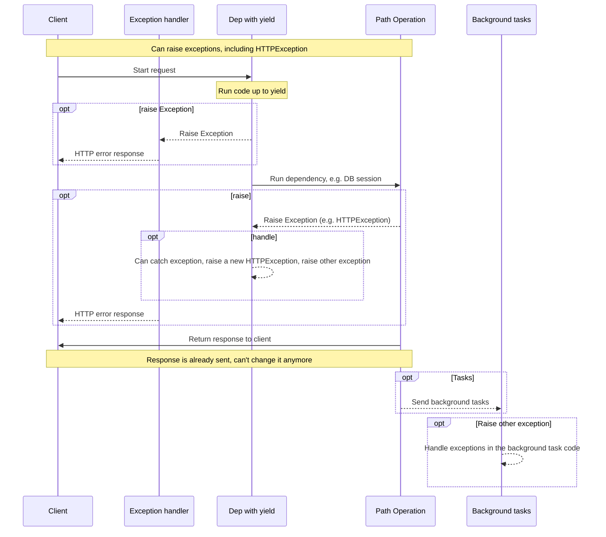
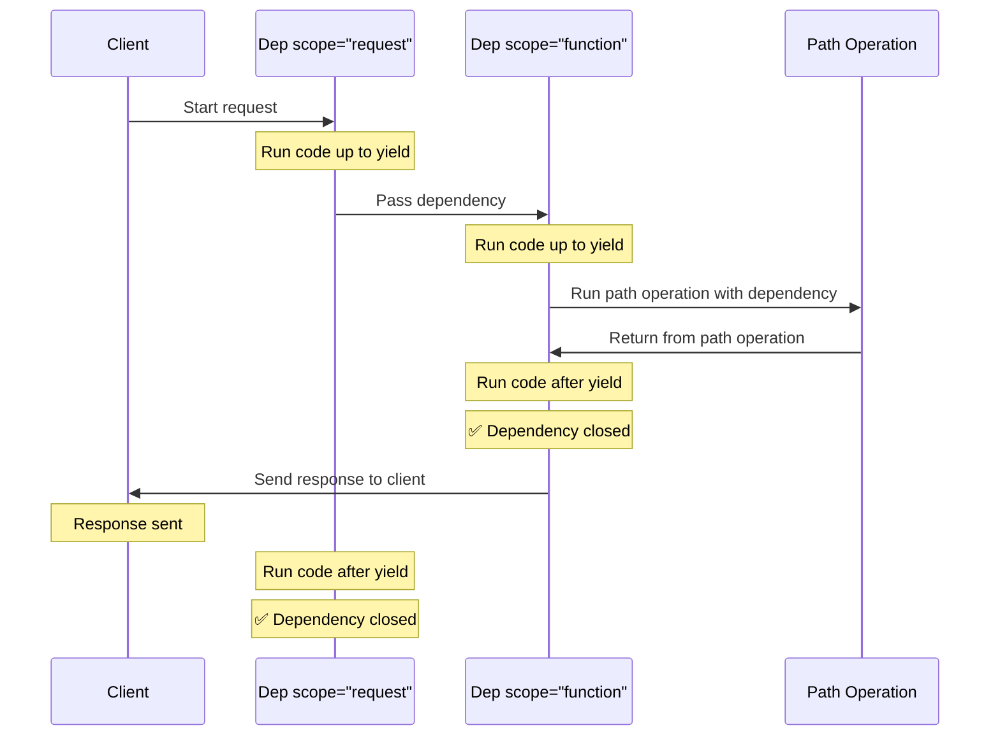

# Vitegemezi vyenye yield { #dependencies-with-yield }

FastAPI inasaidia vitegemezi vinavyofanya <dfn title='wakati mwingine pia huitwa "msimbo wa kuachilia rasilimali", "msimbo wa kusafisha", "msimbo wa kufunga", "msimbo wa kutoka kwenye context manager", n.k.'>hatua za ziada baada ya kumaliza</dfn>.

Ili kufanya hivyo, tumia `yield` badala ya `return`, kisha uandike hatua za ziada (msimbo) baada yake.

/// tip | Kidokezo

Hakikisha unatumia `yield` mara moja tu kwa kila kitegemezi.

///

/// note | Maelezo ya Kiufundi

Function yoyote inayofaa kutumika na:

* [`@contextlib.contextmanager`](https://docs.python.org/3/library/contextlib.html#contextlib.contextmanager) au
* [`@contextlib.asynccontextmanager`](https://docs.python.org/3/library/contextlib.html#contextlib.asynccontextmanager)

inafaa kutumika kama kitegemezi cha **FastAPI**.

Kwa kweli, FastAPI hutumia decorators hizo mbili ndani yake.

///

## Kitegemezi cha database chenye `yield` { #a-database-dependency-with-yield }

Kwa mfano, unaweza kutumia hili kuunda session ya database na kuifunga baada ya kumaliza.

Ni msimbo ulio kabla ya statement ya `yield`, pamoja na statement hiyo yenyewe, pekee unaotekelezwa kabla ya kuunda response:

{* ../../docs_src/dependencies/tutorial007_py310.py hl[2:4] *}

Thamani inayotolewa na `yield` ndiyo inayoingizwa kwenye *path operations* na vitegemezi vingine:

{* ../../docs_src/dependencies/tutorial007_py310.py hl[4] *}

Msimbo unaofuata statement ya `yield` hutekelezwa baada ya response:

{* ../../docs_src/dependencies/tutorial007_py310.py hl[5:6] *}

/// tip | Kidokezo

Unaweza kutumia functions za `async` au functions za kawaida.

**FastAPI** itashughulikia kila moja ipasavyo, kama inavyofanya kwa vitegemezi vya kawaida.

///

## Kitegemezi chenye `yield` na `try` { #a-dependency-with-yield-and-try }

Ukitumia block ya `try` kwenye kitegemezi chenye `yield`, utapokea exception yoyote iliyotokea wakati wa kutumia kitegemezi hicho.

Kwa mfano, ikiwa msimbo fulani wakati wa utekelezaji, kwenye kitegemezi kingine au kwenye *path operation*, ulisababisha transaction ya database kufanya "rollback" au ulizalisha exception nyingine yoyote, ungepokea exception hiyo kwenye kitegemezi chako.

Kwa hiyo, unaweza kushughulikia exception hiyo mahususi ndani ya kitegemezi kwa kutumia `except SomeException`.

Vivyo hivyo, unaweza kutumia `finally` kuhakikisha kuwa hatua za kuachilia rasilimali zinatekelezwa, bila kujali kama kulikuwa na exception au la.

{* ../../docs_src/dependencies/tutorial007_py310.py hl[3,5] *}

## Vitegemezi vya vitegemezi vingine vyenye `yield` { #sub-dependencies-with-yield }

Unaweza kuwa na vitegemezi vya vitegemezi vingine na "trees" zake za ukubwa na umbo lolote, na chochote au vyote vinaweza kutumia `yield`.

**FastAPI** itahakikisha kuwa "msimbo wa kuachilia rasilimali" katika kila kitegemezi chenye `yield` unaendeshwa kwa mpangilio sahihi.

Kwa mfano, `dependency_c` kinaweza kutegemea `dependency_b`, na `dependency_b` kikategemea `dependency_a`:

{* ../../docs_src/dependencies/tutorial008_an_py310.py hl[6,14,22] *}

Na vyote vinaweza kutumia `yield`.

Katika hali hii, ili `dependency_c` kitekeleze msimbo wake wa kuachilia rasilimali, kinahitaji thamani kutoka `dependency_b` (hapa inaitwa `dep_b`) iendelee kupatikana.

Na, kwa upande wake, `dependency_b` kinahitaji thamani kutoka `dependency_a` (hapa inaitwa `dep_a`) ipatikane kwa ajili ya msimbo wake wa kuachilia rasilimali.

{* ../../docs_src/dependencies/tutorial008_an_py310.py hl[18:19,26:27] *}

Vivyo hivyo, unaweza kuwa na vitegemezi fulani vyenye `yield` na vingine vyenye `return`, na baadhi yake vikategemea vingine.

Na unaweza kuwa na kitegemezi kimoja kinachohitaji vitegemezi vingine kadhaa vyenye `yield`, n.k.

Unaweza kuwa na mchanganyiko wowote wa vitegemezi unaotaka.

**FastAPI** itahakikisha kila kitu kinaendeshwa kwa mpangilio sahihi.

/// note | Maelezo ya Kiufundi

Hili linawezekana kutokana na [Context Managers](https://docs.python.org/3/library/contextlib.html) za Python.

**FastAPI** huzitumia ndani yake kufanikisha hili.

///

## Vitegemezi vyenye `yield` na `HTTPException` { #dependencies-with-yield-and-httpexception }

Umeona kwamba unaweza kutumia vitegemezi vyenye `yield` na kuwa na blocks za `try` zinazojaribu kutekeleza msimbo fulani, kisha kuendesha msimbo wa kuachilia rasilimali baada ya `finally`.

Unaweza pia kutumia `except` kunasa exception iliyotokea na kufanya jambo fulani nayo.

Kwa mfano, unaweza kuzalisha exception tofauti, kama vile `HTTPException`.

/// tip | Kidokezo

Hii ni mbinu ya kiwango cha juu kiasi, na mara nyingi hutaihitaji, kwa sababu unaweza kuzalisha exceptions (ikiwemo `HTTPException`) kutoka ndani ya sehemu nyingine za msimbo wa programu yako, kwa mfano, katika *path operation function*.

Lakini ipo kwa ajili yako ukiihitaji. 🤓

///

{* ../../docs_src/dependencies/tutorial008b_an_py310.py hl[18:22,31] *}

Ikiwa unataka kunasa exceptions na kuunda response maalumu kulingana nazo, unda [Exception Handler Maalumu](../handling-errors.md#install-custom-exception-handlers).

## Vitegemezi vyenye `yield` na `except` { #dependencies-with-yield-and-except }

Ukinasa exception kwa kutumia `except` katika kitegemezi chenye `yield` na usiizalishe tena (au kuzalisha exception mpya), FastAPI haitaweza kutambua kuwa kulikuwa na exception, kama ambavyo ingetokea kwa Python ya kawaida:

{* ../../docs_src/dependencies/tutorial008c_an_py310.py hl[15:16] *}

Katika hali hii, client itaona response ya *HTTP 500 Internal Server Error* kama inavyopaswa, kwa kuwa hatuzalishi `HTTPException` au kitu kama hicho, lakini server **haitakuwa na logs zozote** wala dalili nyingine yoyote inayoonyesha kosa lilikuwa nini. 😱

### Tumia `raise` kila wakati katika Vitegemezi vyenye `yield` na `except` { #always-raise-in-dependencies-with-yield-and-except }

Ukinasa exception katika kitegemezi chenye `yield`, isipokuwa kama unazalisha `HTTPException` nyingine au kitu kama hicho, **unapaswa kuzalisha tena exception ya awali**.

Unaweza kuzalisha tena exception ileile kwa kutumia `raise`:

{* ../../docs_src/dependencies/tutorial008d_an_py310.py hl[17] *}

Sasa client itapata response ileile ya *HTTP 500 Internal Server Error*, lakini server itakuwa na `InternalError` yetu maalumu kwenye logs. 😎

## Utekelezaji wa vitegemezi vyenye `yield` { #execution-of-dependencies-with-yield }

Mfuatano wa utekelezaji unafanana kwa kiasi kikubwa na mchoro huu. Muda unaendelea kutoka juu kwenda chini. Na kila column ni mojawapo ya sehemu zinazowasiliana au kutekeleza msimbo.



/// note | Kumbuka

Ni **response moja** tu itakayotumwa kwa client. Inaweza kuwa mojawapo ya responses za hitilafu au itakuwa response kutoka kwenye *path operation*.

Baada ya mojawapo ya responses hizo kutumwa, hakuna response nyingine inayoweza kutumwa.

///

/// tip | Kidokezo

Ukizalisha exception yoyote katika msimbo wa *path operation function*, itapitishwa kwa vitegemezi vyenye yield, ikiwemo `HTTPException`. Mara nyingi utahitaji kuzalisha tena exception ileile au mpya kutoka kwenye kitegemezi chenye `yield` ili kuhakikisha inashughulikiwa ipasavyo.

///

## Kuachilia rasilimali mapema na `scope` { #early-exit-and-scope }

Kwa kawaida, msimbo wa kuachilia rasilimali wa vitegemezi vyenye `yield` hutekelezwa **baada ya response** kutumwa kwa client.

Lakini ikiwa unajua kwamba hutahitaji kutumia kitegemezi baada ya *path operation function* kurudisha matokeo, unaweza kutumia `Depends(scope="function")` kuiambia FastAPI kwamba inapaswa kufunga kitegemezi baada ya *path operation function* kurudisha matokeo, lakini **kabla** ya **response kutumwa**.

{* ../../docs_src/dependencies/tutorial008e_an_py310.py hl[12,16] *}

`Depends()` hupokea kigezo cha `scope` kinachoweza kuwa:

* `"function"`: anza kitegemezi kabla ya *path operation function* inayoshughulikia request, maliza kitegemezi baada ya *path operation function* kumalizika, lakini **kabla** ya response kutumwa kurudi kwa client. Kwa hiyo, function ya kitegemezi itatekelezwa **kabla na baada** ya *path operation **function***.
* `"request"`: anza kitegemezi kabla ya *path operation function* inayoshughulikia request (kama unapotumia `"function"`), lakini maliza **baada** ya response kutumwa kurudi kwa client. Kwa hiyo, function ya kitegemezi itatekelezwa **kabla na baada** ya mzunguko wa **request** na response.

Ikiwa haijabainishwa na kitegemezi kina `yield`, kitakuwa na `scope` ya `"request"` kwa chaguo-msingi.

### `scope` kwa vitegemezi vya vitegemezi vingine { #scope-for-sub-dependencies }

Unapotangaza kitegemezi chenye `scope="request"` (chaguo-msingi), kitegemezi chochote kinachotegemewa nacho kinahitaji pia kuwa na `scope` ya `"request"`.

Lakini kitegemezi chenye `scope` ya `"function"` kinaweza kuwa na vitegemezi vyenye `scope` ya `"function"` na `scope` ya `"request"`.

Hii ni kwa sababu kitegemezi chochote kinahitaji kuweza kuendesha msimbo wake wa kuachilia rasilimali kabla ya vitegemezi kinavyovitegemea, kwa kuwa huenda bado kikahitaji kuvitumia wakati wa kuendesha msimbo huo.



## Vitegemezi vyenye `yield`, `HTTPException`, `except` na Background Tasks { #dependencies-with-yield-httpexception-except-and-background-tasks }

Vitegemezi vyenye `yield` vimebadilika kadiri muda ulivyopita ili kushughulikia hali mbalimbali za matumizi na kutatua baadhi ya matatizo.

Ikiwa unataka kuona kilichobadilika katika matoleo tofauti ya FastAPI, unaweza kusoma zaidi katika mwongozo wa kiwango cha juu, kwenye [Vitegemezi vya Kiwango cha Juu - Vitegemezi vyenye `yield`, `HTTPException`, `except` na Background Tasks](../../advanced/advanced-dependencies.md#dependencies-with-yield-httpexception-except-and-background-tasks).

## Context Managers { #context-managers }

### "Context Managers" ni nini { #what-are-context-managers }

"Context Managers" ni objects zozote za Python unazoweza kutumia katika statement ya `with`.

Kwa mfano, [unaweza kutumia `with` kusoma faili](https://docs.python.org/3/tutorial/inputoutput.html#reading-and-writing-files):

```Python
with open("./somefile.txt") as f:
    contents = f.read()
    print(contents)
```

Ndani yake, `open("./somefile.txt")` huunda object inayoitwa "Context Manager".

Block ya `with` inapomalizika, huhakikisha faili limefungwa, hata kama kulikuwa na exceptions.

Unapounda kitegemezi chenye `yield`, **FastAPI** itakiundia context manager ndani yake, na kuiunganisha na zana nyingine zinazohusiana nayo.

### Kutumia context managers katika vitegemezi vyenye `yield` { #using-context-managers-in-dependencies-with-yield }

/// warning | Onyo

Hili ni wazo la "kiwango cha juu" kwa kiasi fulani.

Ikiwa ndio unaanza kutumia **FastAPI**, unaweza kuliruka kwa sasa.

///

Katika Python, unaweza kuunda Context Managers kwa [kuunda class yenye methods mbili: `__enter__()` na `__exit__()`](https://docs.python.org/3/reference/datamodel.html#context-managers).

Unaweza pia kuzitumia ndani ya vitegemezi vya **FastAPI** vyenye `yield` kwa kutumia
statements za `with` au `async with` ndani ya function ya kitegemezi:

{* ../../docs_src/dependencies/tutorial010_py310.py hl[1:9,13] *}

/// tip | Kidokezo

Njia nyingine ya kuunda context manager ni kutumia:

* [`@contextlib.contextmanager`](https://docs.python.org/3/library/contextlib.html#contextlib.contextmanager) au
* [`@contextlib.asynccontextmanager`](https://docs.python.org/3/library/contextlib.html#contextlib.asynccontextmanager)

kama decorators za function yenye `yield` moja tu.

Hicho ndicho **FastAPI** hutumia ndani yake kwa vitegemezi vyenye `yield`.

Lakini huhitaji kutumia decorators hizo kwa vitegemezi vya FastAPI (na hupaswi kuzitumia).

FastAPI itakufanyia hilo ndani yake.

///
